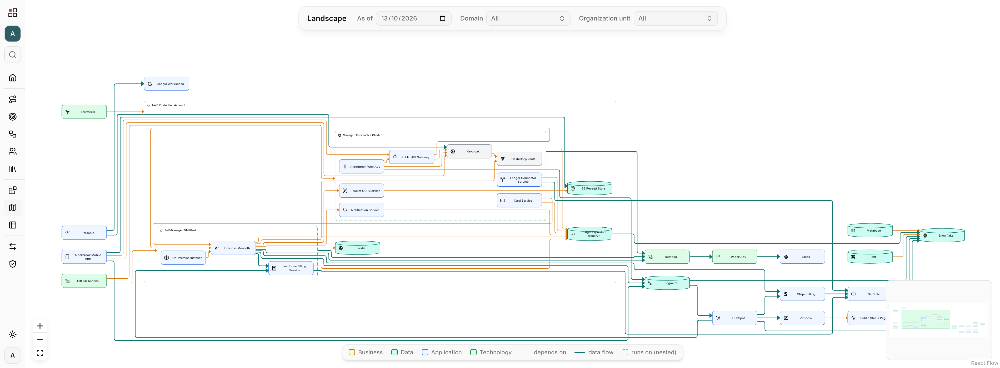

Self-hosted, open-source Enterprise Architecture Management.

> [!WARNING]
> Early stage. There is no release yet; the schema, the bundle format and the
> API can still change without notice. Run it to explore, not to depend on.



Model what your organization is able to do (capabilities, value streams,
processes), map that to the systems realizing it, and keep both connected as
they change. Everything is scoped to an **enterprise**: a corporate group, a
department, or a household.

Every relationship carries a validity interval, so the landscape is
reconstructible for **any date**. Set `as of` to last year and you see what ran
where last year, retired systems included. *What still runs on the platform we
are switching off, and what breaks if we do?* becomes a question the model
answers.

## What works today

- Business capabilities, value streams with stages, business processes with BPMN modelling
- Building blocks (architecture and solution), typed relationships, auto-laid-out landscape diagram, icons
- Export and import of a whole enterprise as a JSON bundle
- Accounts with roles per enterprise (owner, editor, viewer); the first account is the instance admin
- Instance branding: name, logo and icon

What is known to be missing is in [docs/BACKLOG.md](docs/BACKLOG.md).

## Run it

### Self-hosted, with Docker

```bash
cp .env.example .env   # set POSTGRES_PASSWORD; OPENEAM_PORT if 8080 is taken
docker compose --profile app up -d --build
```

Open http://localhost:8080 and create the first account; it becomes the
instance admin, who creates further accounts from the Administration page. Set
`AUTH_COOKIE_SECURE=true` once the instance is behind TLS.

### For development

Needs Node 24 and pnpm 12 (`.node-version` pins Node; we use
[fnm](https://github.com/Schniz/fnm)), plus Docker for Postgres.

```bash
cp .env.example .env
pnpm install
docker compose up -d   # Postgres only
pnpm db:migrate
pnpm dev
```

- Web: http://localhost:3000
- GraphQL: http://localhost:4000/graphql (GraphiQL is on outside production)

## See it with data

Two example models live in [examples/](examples/): [`household.json`](examples/household.json),
the smallest model that still shows the metamodel, and
[`alderbrook.json`](examples/alderbrook.json), a fictional SaaS company mid-way
through a platform migration. Sign in once for a token, then import:

```bash
TOKEN=$(curl -s http://localhost:4000/graphql -H "Content-Type: application/json" \
  -d '{"query":"mutation { signIn(input:{email:\"you@example.com\", password:\"…\"}) { token } }"}' \
  | jq -r .data.signIn.token)

curl -X POST http://localhost:4000/api/data-exchange/import \
  -H "Authorization: Bearer $TOKEN" \
  -H "Content-Type: application/json" \
  --data-binary @examples/alderbrook.json
```

Import replaces only the enterprises the bundle contains; the importing account
becomes a member of each.

## Documentation

- [VISION.md](docs/VISION.md), [USE-CASES.md](docs/USE-CASES.md), [USER-STORIES.md](docs/USER-STORIES.md): why, and what next
- [ARCHITECTURE.md](docs/ARCHITECTURE.md), [DATABASE.md](docs/DATABASE.md), [GLOSSARY.md](docs/GLOSSARY.md), [DECISIONS.md](docs/DECISIONS.md): how it is built, and why that way
- [BACKLOG.md](docs/BACKLOG.md), [IDEAS.md](docs/IDEAS.md): known defects and committed work, and the parking lot

Contributions welcome; start with [CONTRIBUTING.md](CONTRIBUTING.md).

## Stack

NestJS + GraphQL (Apollo Server) · React + Vite + TanStack Router · Postgres +
Drizzle · TypeScript · pnpm workspaces · Biome.

```
apps/api     NestJS backend — GraphQL, sessions, data exchange, icons, /health
apps/web     React + Vite SPA
packages/db  Drizzle schema, migrations, connection
examples/    Importable example models
```

## License

[Apache-2.0](LICENSE)

Bundled icon sets: [Lucide](https://lucide.dev) (ISC) and
[Simple Icons](https://simpleicons.org) (CC0 1.0). CC0 covers the SVGs, not
the trademarks; logos only identify the systems a model names.
