# Database schema

The Postgres schema as `packages/db/src/schema/` declares it and
`packages/db/drizzle/0000_*.sql` creates it. [ARCHITECTURE.md](ARCHITECTURE.md)
says why the model has this shape; [GLOSSARY.md](GLOSSARY.md) defines the terms;
this file says what is physically there and which rules the database itself
enforces. Regenerate the migration (`pnpm db:generate`) whenever the schema
changes, and update this file in the same commit.

## Conventions

- **Ids are `uuid`**, generated by Postgres (`gen_random_uuid()`), globally
  unique across enterprises (INV-10). Example bundles use deterministic UUIDv5
  values (D-8).
- **Names** are `snake_case`; tables are plural; link tables are named after the
  two sides (`capability_actors`) or the owning side (`building_block_capabilities`).
- **`created_at` / `updated_at`** (`timestamptz`, default `now()`) on every table
  that is more than a pure join. `updated_at` is set by the application on
  update, not by a trigger.
- **Validity intervals** are `date` columns `valid_from` / `valid_to`, half-open
  (`[from, to)`), `NULL` meaning unbounded on that side (INV-1). A CHECK on
  every such table refuses empty intervals.
- **Deletes cascade** from an enterprise down to everything modelled in it, and
  from a parent row to its link rows. The one `SET NULL` is
  `actors.organization_unit_id`: a team outlives the unit it pointed at.
- **Enterprise consistency.** Rows that carry `enterprise_id` and reference
  another row that carries it use a composite foreign key
  `(ref_id, enterprise_id) → (id, enterprise_id)`, so the database refuses a
  reference into another enterprise. Link rows without an `enterprise_id` of
  their own are kept inside one enterprise by the services and the bundle
  validator (INV-9/11/14), not by the database.
- **Closed sets are Postgres enums.** Architecture domains are deliberately
  rows, not an enum (D-2).

## Entity relationship diagram

```mermaid
erDiagram
    users ||--o{ sessions : "signs in as"
    users ||--o{ enterprise_members : ""
    enterprises ||--o{ enterprise_members : ""
    enterprises ||--o{ business_capabilities : ""
    enterprises ||--o{ business_processes : ""
    enterprises ||--o{ value_streams : ""
    enterprises ||--o{ architecture_domains : ""
    enterprises ||--o{ organization_units : ""
    enterprises ||--o{ building_blocks : ""
    enterprises ||--o{ information_objects : ""
    enterprises ||--o{ actors : ""

    business_capabilities ||--o{ business_processes : "delivered by"
    business_processes ||--o{ process_steps : ""
    value_streams ||--o{ value_stream_stages : ""
    value_stream_stages ||--o{ stage_capabilities : ""
    business_capabilities ||--o{ stage_capabilities : ""
    organization_units |o--o{ organization_units : "parent"

    building_blocks ||--o{ building_block_architecture_domains : ""
    architecture_domains ||--o{ building_block_architecture_domains : ""
    building_blocks ||--o{ building_block_organization_units : ""
    organization_units ||--o{ building_block_organization_units : ""
    building_blocks ||--o{ building_block_realizations : "ABB"
    building_blocks ||--o{ building_block_realizations : "SBB"
    building_blocks ||--o{ building_block_capabilities : ""
    business_capabilities ||--o{ building_block_capabilities : ""
    building_blocks ||--o{ building_block_relationships : "source"
    building_blocks ||--o{ building_block_relationships : "target"

    business_capabilities ||--o{ capability_information : ""
    information_objects ||--o{ capability_information : ""
    business_capabilities ||--o{ capability_actors : ""
    actors ||--o{ capability_actors : ""
    organization_units |o--o{ actors : "team is"
```

## Enums

| Enum | Values |
| --- | --- |
| `instance_role` | `admin`, `user` |
| `setup_token_purpose` | `setup`, `reset` |
| `enterprise_role` | `owner`, `editor`, `viewer` |
| `instance_asset_kind` | `logo`, `logo_dark`, `icon` |
| `capability_direction` | `invest`, `sustain`, `commodity`, `sunset` |
| `building_block_kind` | `architecture`, `solution` |
| `architecture_level` | `strategic`, `segment`, `capability` |
| `lifecycle_phase` | `planned`, `active`, `phasing_out`, `retired` |
| `building_block_relationship_type` | `depends_on`, `data_flow`, `hosted_on` |
| `information_usage` | `owns`, `creates`, `uses` |
| `actor_kind` | `role`, `team`, `individual`, `external` |
| `actor_involvement` | `accountable`, `performs`, `consulted` |

## Tables

Columns common to almost every table are not repeated: `id uuid PK default
gen_random_uuid()`, `created_at`, `updated_at`. "FK" means `ON DELETE CASCADE`
unless stated. Every foreign-key column has a btree index.

### Access

**`users`** — accounts. `email text UNIQUE` (CHECK lowercased), `display_name
text`, `password_hash text NULL` (scrypt, self-describing; null until set through a
setup link, and such an account cannot sign in), `instance_role
instance_role default 'user'`, `disabled_at timestamptz NULL`.

**`password_setup_tokens`** — one-time links through which a person sets
their own password (D-19). `user_id FK users`, `token_hash text UNIQUE`
(SHA-256), `purpose setup_token_purpose`, `expires_at timestamptz`, `used_at
timestamptz NULL`, `issued_by uuid NULL FK users ON DELETE SET NULL`. Issuing a
new link marks the account's earlier unused ones as used.

**`sessions`** — one per signed-in browser or script. `token_hash text UNIQUE`
(SHA-256 of the token; the token itself is never stored), `user_id FK users`,
`expires_at timestamptz` (indexed).

**`enterprise_members`** — who may reach an enterprise, and as what (INV-16,
D-20). PK `(enterprise_id, user_id)`, both FK; `role enterprise_role default
'editor'`. Index on `user_id`. No id.

**`instance_settings`** — one row, `id text PK` with CHECK `id = 'instance'`;
`sign_up_open boolean default false`. Instance branding (D-23): `name NULL`, the instance's own name.

**`instance_assets`** — the branding images (D-23): `kind instance_asset_kind
PK` (`logo`, `logo_dark`, `icon`), `bytes bytea`, `mime`. One row per slot, at
most 512 KB each; in the database rather than on disk so a backup carries them
and the API container stays stateless.

### Scope

**`enterprises`** — `name text`, `description text NULL`, `goal text NULL`,
`avatar_bg_color text NULL`, `avatar_text_color text NULL`. The root of every
cascade.

### Business layer

**`business_capabilities`** — `enterprise_id FK`, `name`, `description NULL`,
`direction capability_direction NULL`. UNIQUE `(id, enterprise_id)` exists so
children can reference both together.

**`business_processes`** — `enterprise_id FK`, `capability_id uuid`, `name`,
`description NULL`, `trigger_event NULL`, `outcome NULL`, `bpmn_xml text NULL`.
Composite FK `(capability_id, enterprise_id) → business_capabilities (id,
enterprise_id)` (INV-6: a process lives in its capability's enterprise).

**`process_steps`** — `process_id FK business_processes`, `name`, `position
integer`. UNIQUE `(process_id, position)`. Re-derived from `bpmn_xml` on every
diagram save (INV-7).

**`value_streams`** — `enterprise_id FK`, `name`, `description NULL`.

**`value_stream_stages`** — `value_stream_id FK`, `name`, `position integer`.
UNIQUE `(value_stream_id, position)`.

**`stage_capabilities`** — PK `(stage_id, capability_id)`, both FK; `position
integer`, UNIQUE `(stage_id, position)`. No timestamps.

### Organization

**`organization_units`** — `enterprise_id FK`, `name`, `description NULL`,
`parent_id uuid NULL`. UNIQUE `(id, enterprise_id)`; composite FK `(parent_id,
enterprise_id) → organization_units (id, enterprise_id)` cascading, so a
parent is always in the same enterprise and deleting it removes the subtree;
CHECK `parent_id IS DISTINCT FROM id`.

**`architecture_domains`** — `enterprise_id FK`, `name`, `description NULL`,
`is_default boolean default false`. UNIQUE `(enterprise_id, name)`. Four TOGAF
domains are seeded per enterprise (D-2).

### Architecture layer

**`building_blocks`** — `enterprise_id FK`, `kind building_block_kind`, `name`,
`description NULL`, `icon NULL` (an Iconify id such as `simple-icons:postgresql`;
its shape and collection are checked by the API, D-22), `architecture_level
architecture_level NULL`,
`lifecycle_phase lifecycle_phase default 'planned'`, `valid_from`, `valid_to`.
CHECK validity (INV-1); CHECK `architecture_level IS NULL OR kind =
'architecture'` (INV-3). ABBs and SBBs share the table (D-1).

**`building_block_architecture_domains`** — PK `(building_block_id,
architecture_domain_id)`, both FK. No timestamps, no validity (D-5).

**`building_block_organization_units`** — `building_block_id FK`,
`organization_unit_id FK`, `valid_from`, `valid_to`. CHECK validity.

**`building_block_realizations`** — `architecture_building_block_id FK
building_blocks`, `solution_building_block_id FK building_blocks`,
`valid_from`, `valid_to`. CHECK validity; CHECK the two ids differ. That the
first is an ABB and the second an SBB is enforced by the services and the
bundle validator, not the database.

**`building_block_capabilities`** — `building_block_id FK`, `capability_id FK`,
`valid_from`, `valid_to`. CHECK validity.

**`building_block_relationships`** — `source_building_block_id FK`,
`target_building_block_id FK`, `type building_block_relationship_type default
'depends_on'`, `description NULL`, `valid_from`, `valid_to`. CHECK validity;
CHECK `source <> target` (INV-4); partial UNIQUE INDEX on
`(source_building_block_id) WHERE type = 'hosted_on' AND valid_to IS NULL`
(INV-5: one open hosting edge per block).

### Information

**`information_objects`** — `enterprise_id FK`, `name`, `description NULL`.

**`capability_information`** — `capability_id FK`, `information_object_id FK`,
`usage information_usage default 'uses'`, `valid_from`, `valid_to`. CHECK
validity; partial UNIQUE INDEX on `(capability_id, information_object_id)
WHERE valid_to IS NULL` (INV-12).

### Actors

**`actors`** — `enterprise_id FK`, `kind actor_kind`, `name`, `description
NULL`, `organization_unit_id uuid NULL FK organization_units ON DELETE SET
NULL`. CHECK `organization_unit_id IS NULL OR kind = 'team'` (INV-13);
composite FK `(organization_unit_id, enterprise_id) → organization_units (id,
enterprise_id)` with no action, so the unit is in the same enterprise while
both are set.

**`capability_actors`** — `capability_id FK`, `actor_id FK`, `involvement
actor_involvement default 'performs'`, `valid_from`, `valid_to`. CHECK
validity; partial UNIQUE INDEX on `(capability_id, actor_id) WHERE valid_to IS
NULL` (INV-15).

## Which rules the database enforces

| Invariant | In the database as |
| --- | --- |
| INV-1 half-open, non-empty intervals | `*_validity_check` on all seven temporal tables |
| INV-3 level only on ABBs | `building_blocks_level_only_for_architecture_check` |
| INV-4 no self-relationship | `building_block_relationships_no_self_check` |
| INV-5 one open `hosted_on` per block | `building_block_relationships_one_open_host_idx` |
| INV-6 process in its capability's enterprise | `business_processes_capability_fk` |
| INV-10 globally unique ids | `uuid` primary keys |
| INV-12 one open capability–information link | `capability_information_one_open_per_pair_idx` |
| INV-13 unit only on teams, same enterprise | `actors_organization_unit_only_for_team_check`, `actors_organization_unit_same_enterprise_fk` |
| INV-15 one open capability–actor link | `capability_actors_one_open_per_pair_idx` |
| INV-16 membership | `enterprise_members` primary key and cascades |
| INV-17 at least one admin | not expressible; `admin.service.ts` |
| INV-18 at least one owner per enterprise | not expressible; `enterprises.service.ts` |
| INV-2, INV-7, INV-9/11/14 for id-only links, ABB/SBB sides of a realization | services and `data-bundle.validator.ts` |

When a constraint does fire, `common/pg-error.filter.ts` turns it into a 400 or
409 naming the constraint, so a client never sees a bare database error.

## Migrations

Generated with drizzle-kit from the schema and applied by `pnpm db:migrate`
(development) or by the API container on startup (`packages/db/src/migrate.ts`).
The history before the schema was hardened was collapsed into the `0000`
baseline (D-18); everything since is an ordinary migration on top of it.
